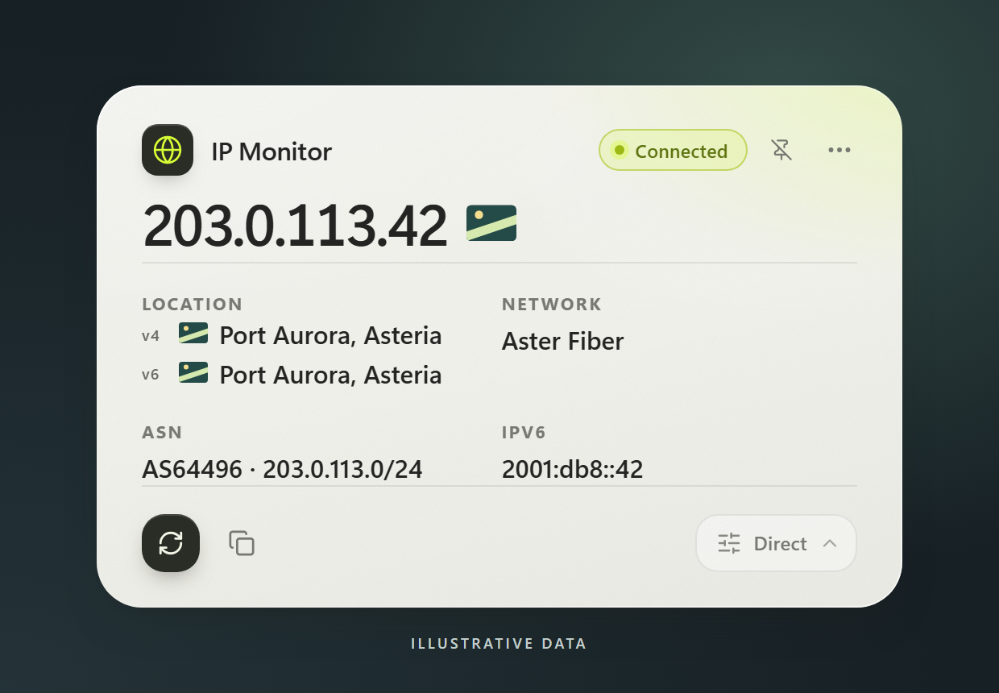

# IP Monitor

IP Monitor 是一张面向 Windows 11 的半透明桌面卡片，用来查看检测请求的公网出口。它分别查询 IPv4 和 IPv6，并显示查询服务返回的城市、国家或地区、运营商和 ASN。应用使用 Tauri 2 和 Vue 3。

*界面使用合成数据渲染。IP 地址、网段和 ASN 均为文档示例，Asteria、Port Aurora、Aster Fiber 和旗帜均为虚构。*

## Windows 使用

从源码构建后，可以直接运行 `ip-monitor.exe`，也可以运行 NSIS 安装程序为当前 Windows 用户安装。运行需要 Microsoft Edge WebView2 Runtime。

1. 启动后，卡片默认用 **Direct** 检测。通过右下角菜单切换检测模式，点击刷新按钮重新查询，或用复制按钮获取带检测时间和路径的快照。
2. 拖动卡片调整位置，点击图钉切换置顶。可从系统托盘显示卡片或退出应用。
3. 应用每 120 秒检测直连、系统代理和已配置的自定义代理。任一路已知的 IPv4 或 IPv6 地址发生变化，折叠卡片就会自动展开。卡片仍显示所选模式。首次取得地址或请求失败不会触发展开。
4. 默认在登录 Windows 后启动，可在省略号菜单中关闭。应用会记住你在新版里的选择。

## 检测模式

| 模式 | 请求路径 |
| --- | --- |
| **Direct** | 应用关闭 HTTP 客户端的代理发现，直接发起检测请求。操作系统的路由仍然生效，VPN 或 TUN 可能影响出口。 |
| **System Proxy** | 读取当前 Windows 用户的手动系统代理设置。未配置可用代理，或启用了 PAC / WPAD 自动配置时，检测会报错。 |
| **Custom Proxy** | 使用在卡片中填写的 HTTP、HTTPS 或 SOCKS5 代理，可提供用户名和密码。SOCKS5 由代理端解析目标域名。 |

代理模式的检测请求始终走所选代理。检测失败时，应用报告错误并保留所选模式。快照中的路径对应产生该结果的请求方式，只反映本应用对查询服务的访问。IPv4 和 IPv6 独立查询，两项成功显示 `Connected`，只有一项成功显示 `Partial`。如果新一轮检测失败且已有旧结果，卡片会标记为 `Stale`，并保留旧结果的时间和路径。

## 使用限制

- 检测通过所选路径向 `ipv4.ipleak.net` 和 `ipv6.ipleak.net` 发起 HTTPS 请求。结果取决于服务可用性和该路径的连通性。归属地是服务返回的估计值。
- 卡片采用半透明填充。贴边折叠、展开动画和失焦外观仍在验证，跨屏和不同 DPI 的实机覆盖有限。

国旗素材来自 flag-icons，许可见 [MIT 许可](src/assets/flags/LICENSE)。
